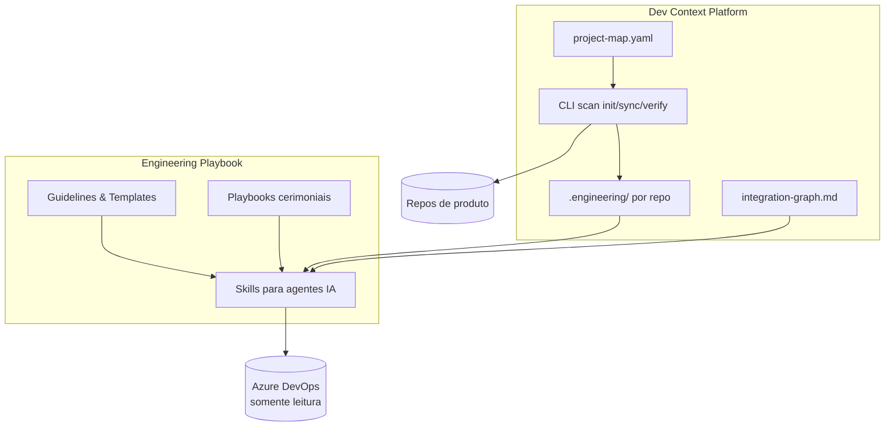

# Ganhos Estratégicos — Engineering Playbook + Dev Context Platform

Material para apresentação executiva. Cada seção principal pode virar 1–2 slides.

**Público-alvo:** gestores, delivery, product owners, tech leads  
**Status:** piloto em AtivosCompraMobilizacao  
**Repositório:** [engineering-playbook](../README.md)

## Apresentação (slides)

| Formato | Arquivo | Como usar |
|---------|---------|-----------|
| **PowerPoint** | [apresentacao-dcp-gestores.pptx](apresentacao-dcp-gestores.pptx) | Abrir no PowerPoint / Google Slides |
| **HTML** | [apresentacao-dcp-gestores.html](apresentacao-dcp-gestores.html) | Abrir no navegador — setas ou swipe para navegar |
| **Marp (fonte)** | [apresentacao-dcp-gestores.slides.md](apresentacao-dcp-gestores.slides.md) | Editar e reexportar com Marp CLI ou extensão VS Code |

---

## Slide 1 — Resumo executivo

**O que é:** uma plataforma interna que padroniza como o time define requisitos, valida prontidão, mapeia código e prepara desenvolvimento — com IA assistida e guardrails.

### Problema que resolve

| Dor atual | Consequência |
|-----------|--------------|
| Processo disperso (Notion, Slack, cabeça das pessoas) | Retrabalho, inconsistência entre squads |
| Contexto técnico difícil de achar | Análise lenta, dependência de devs sênior |
| IA usada sem padrão | Alucinações, sugestões fora do processo, risco em ADO |
| Multi-repo sem mapa claro | US mal estimada, escopo esquecido, repos legados usados por engano |

### Proposta de valor

> *Institucionalizar o conhecimento de engenharia e dar contexto confiável à IA — do refinamento ao primeiro commit — reduzindo risco, tempo e dependência de pessoas-chave.*

---

## Slide 2 — Visão geral: dois pilares integrados



| Pilar | Papel | Onde vive |
|-------|-------|-----------|
| **Engineering Playbook** | *Como* o time trabalha — regras, templates, processos, skills | Repositório central `engineering-playbook` |
| **Dev Context Platform (DCP)** | *O quê* existe no código — mapa, KB, grafo de integrações | `project-context/` + pasta `.engineering/` em cada repo |

Os dois se conectam no pipeline: skills consomem guidelines **e** contexto técnico indexado.

---

## Slide 3 — O problema estratégico

### 1. Conhecimento frágil

Quando um dev sênior ou analista experiente sai, leva consigo:

- onde ficam as rotinas batch, views DW, integrações SAP;
- quais repos são ativos vs legados;
- decisões de processo que nunca viraram documento.

### 2. Custo oculto do refinamento

USs entram na sprint com lacunas (RN sem CA, data indefinida, escopo ambíguo). O custo aparece **depois** — em retrabalho, bugs, reuniões de alinhamento.

### 3. IA sem governança

Times já usam ChatGPT/Cursor, mas:

- sem template de US → saídas inconsistentes;
- sem política ADO → risco de alteração indevida no backlog;
- sem contexto de código → planos genéricos ou incorretos.

### 4. Complexidade multi-repo

Produtos como **AtivosCompraMobilizacao** têm dezenas de repos (backend, front, identity, auditoria, SQL deploy, legado). Sem mapa central, cada US vira uma caça ao tesouro.

---

## Slide 4 — Engineering Playbook: o que entrega

Repositório vivo com **4 tipos de artefato**, cada um com função clara:

| Tipo | Exemplo | Para quem |
|------|---------|-----------|
| **Guideline** | `us-guidelines.md`, `coding-standards.md` | Regra canônica do time |
| **Template** | `us-template.md`, `feature-template.md` | Estrutura mínima de documento |
| **Playbook** | `sprint-planning.md`, `feature-refinement.md` | Cerimônias conduzidas por **pessoas** |
| **Skill** | `requirements-analyst`, `sprint-readiness-reviewer` | Instruções operacionais para **agentes IA** |

### Princípios explícitos

1. Simplicidade antes de complexidade
2. Documentar só o necessário
3. Padronizar para reduzir ambiguidade
4. Registrar decisões (ADRs)
5. Evoluir via Pull Request — nada imposto de cima sem revisão

### Ganho estratégico

> **Processo versionado e auditável** — mudanças passam por PR, com motivação e impacto documentados. Não é wiki morta.

**Referências:** [README.md](../README.md) · [skills/README.md](../skills/README.md)

---

## Slide 5 — Pipeline ponta a ponta

```text
Descoberta          → product-discovery (playbook)
Refinamento         → feature-refinement (playbook)
Feature aprovada    → guidelines + templates
Decomposição        → requirements-analyst (skill)
Revisão funcional   → requirements-reviewer (skill)
Revisão técnica     → tech-lead-reviewer (skill)
Prontidão sprint    → sprint-readiness-reviewer (skill)
Pré-estimativa      → us-estimator (skill)
Sprint planning     → sprint-planning (playbook)
─────────────────── NOVO ───────────────────
Scan / KB           → project-scanner (DCP)
Plano implementação → us-implementation-planner (DCP)
─────────────────────────────────────────────
Desenvolvimento + QA
```

Ver fluxo completo: [playbooks/PIPELINE.md](../playbooks/PIPELINE.md)

### Por que isso importa para gestão

| Etapa | Gate de qualidade | Evita |
|-------|-------------------|-------|
| requirements-reviewer | US mal escrita | Dev interpretar errado |
| tech-lead-reviewer | RN técnica inviável | Surpresa na implementação |
| sprint-readiness | Go/no-go explícito | US incompleta na sprint |
| us-estimator | Ordem de grandeza antes do planning | Sub/super-estimativa crônica |
| **DCP verify** | KB alinhada à branch | Plano baseado em código desatualizado |
| **us-implementation-planner** | RN → tarefa técnica | Dev começar do zero toda vez |

---

## Slide 6 — Skills disponíveis hoje

| Domínio | Skill | Ganho imediato |
|---------|-------|----------------|
| Product | [requirements-analyst](../skills/product/requirements-analyst/SKILL.md) | Feature → USs no padrão do time |
| Product | [requirements-reviewer](../skills/product/requirements-reviewer/SKILL.md) | Qualidade antes do backlog |
| Delivery | [tech-lead-reviewer](../skills/delivery/tech-lead-reviewer/SKILL.md) | Viabilidade técnica e RNs |
| Delivery | [sprint-readiness-reviewer](../skills/delivery/sprint-readiness-reviewer/SKILL.md) | Relatório go/no-go por US ou sprint inteira |
| Delivery | [us-estimator](../skills/delivery/us-estimator/SKILL.md) | Pré-estimativa em horas |
| Development | [project-scanner](../skills/development/project-scanner/SKILL.md) | Scan de repos, KB, sync-state |
| Development | [dcp-bootstrap](../skills/development/dcp-bootstrap/SKILL.md) | Setup automático (Python, venv, Roslyn) |
| Development | [us-implementation-planner](../skills/development/us-implementation-planner/SKILL.md) | Plano executável grounded no código |

### Roadmap (planejado)

| Skill | Domínio |
|-------|---------|
| qa-test-designer | QA — casos de teste a partir de US |
| refinement-facilitator | Product — conduzir refinamento com IA |
| pr-reviewer, code-reviewer | Development — revisão assistida pós-dev |
| release-reviewer | Delivery — complementar devops |

### Portabilidade

Skills seguem padrão aberto Agent Skills — funcionam em **Cursor, Claude Code, Antigravity** via symlink/submodule. Investimento não preso a uma IDE.

---

## Slide 7 — Dev Context Platform: arquitetura

Documentação: [project-context/README.md](../project-context/README.md)

### Camadas de contexto (L0 → L5)

| Camada | Artefato | Conteúdo | Uso |
|--------|----------|----------|-----|
| **L0** | `project-map.yaml` | Lista de repos, status, branch ref, owners | "Quais repos existem? Qual é legado?" |
| **L1** | `repo-profile.yaml` | Stack, padrões, quality score, integrações | "Como é este repo?" |
| **L2** | `kb/manifest.json` | Índice de keywords → nós KB | Busca rápida por termo da US |
| **L3** | `kb/nodes/*.md` | Contrato, dependências, fluxo, efeitos colaterais | Entender classe/job/repository |
| **L4** | Deep-flow | Handler crítico expandido | Só quando L3 insuficiente |
| **L5** | Código-fonte | Leitura direta do repo | Fallback quando KB stale ou miss |

### Artefatos por repo de produto (`.engineering/`)

```text
.engineering/
├── repo-profile.yaml      # Perfil arquitetural (gerado)
├── README.engineering.md  # Resumo humano
├── sync-state.json        # Estado do scan por branch
└── kb/
    ├── manifest.json      # Índice searchable
    └── nodes/             # Notas técnicas (WikiLinks)
```

### Artefatos centralizados por produto ADO

```text
project-context/projects/{Produto}/
├── project-map.yaml       # Mapa de todos os repos
├── scan-state.json        # Estado global do scan
└── integration-graph.md   # Dependências cross-repo
```

---

## Slide 8 — DCP: como funciona na prática

### CLI determinística (sem LLM na indexação)

| Comando | Função |
|---------|--------|
| `dcp init` | Primeiro scan; descobre repos ADO; gera project-map |
| `dcp sync` | Scan incremental na branch de referência |
| `dcp status` | Staleness — KB atrasada? |
| `dcp verify` | Alinha branch de implementação vs KB |

**Regra crítica:** indexação usa detectors + Roslyn (C#) — **não usa LLM**. Documentação técnica é reproduzível e confiável.

```powershell
# Windows — a partir da raiz do engineering-playbook
.\project-context\scripts\dcp.ps1 status --project AtivosCompraMobilizacao
.\project-context\scripts\dcp.ps1 init --project AtivosCompraMobilizacao
.\project-context\scripts\dcp.ps1 verify --project AtivosCompraMobilizacao --repo sima-backend --branch main
```

### Vereditos do `verify` (governança)

| Status | Significado | Ação |
|--------|-------------|------|
| **aligned** | KB e branch OK | Prosseguir com plano |
| **ref_stale** | KB atrás da ref branch | Bloquear plano até sync |
| **branch_delta** | Arquivos mudaram na branch | Alertar dev |
| **divergent** | KB e branch conflitam | Bloquear — ler código (L5) |
| **not_indexed** | Repo nunca scaneado | Executar init/sync |

### Ganho estratégico

> **Confiança no contexto.** A IA não "inventa" arquitetura — consulta KB indexada ou declara explicitamente que está inferindo do código.

---

## Slide 9 — Ganhos por stakeholder

### Para gestão / delivery

| Ganho | Como medir |
|-------|------------|
| **Previsibilidade de sprint** | % US "Pronta" no sprint-readiness antes do planning |
| **Menos carry-over por lacuna** | US devolvidas por RN/CA incompleto |
| **Visibilidade multi-repo** | project-map com status active/legacy/discontinued |
| **Governança de IA** | Política ADO read-only; skills versionadas |
| **Escalabilidade entre squads** | Mesmo playbook, submodule nos projetos |

### Para analistas / product owners

| Ganho | Detalhe |
|-------|---------|
| **Padrão único de US** | Template + guidelines + skills de revisão |
| **Onboarding em 15–30 min** | [analyst-onboarding.md](../ai/analyst-onboarding.md) — funciona até sem Git |
| **Revisão repetível** | Copiar US → skill → sugestões → aplicar manualmente no ADO |
| **Lacunas explícitas** | Skills não inventam RN; listam perguntas para negócio |

### Para tech leads / arquitetura

| Ganho | Detalhe |
|-------|---------|
| **Mapa de repos e legados** | Evita implementar em repo legado por engano |
| **Integration graph** | Dependências cross-repo visíveis |
| **Revisão técnica padronizada** | tech-lead-reviewer antes do sprint |
| **ADRs centralizados** | Decisões arquiteturais preservadas |

### Para desenvolvedores

| Ganho | Detalhe |
|-------|---------|
| **Plano antes de codar** | RN → CA → tarefas → arquivos prováveis → riscos |
| **Menos "onde fica isso?"** | KB com contrato, fluxo, efeitos colaterais |
| **Branch verify** | Sabe se documentação está alinhada ao que vai implementar |
| **Handoff pós-PR** | `scan sync --branch` mantém KB atualizada |

---

## Slide 10 — Diferencial vs "só usar IA"

| Abordagem ad-hoc | Engineering Playbook + DCP |
|------------------|----------------------------|
| Prompt livre no ChatGPT | Skill com checklist, exemplos e referências |
| Contexto = o que o dev lembra | L0–L5 carregados por keywords da US |
| Plano genérico | Plano cita `[KB @ commit]` ou `[Código @ branch]` |
| Sem gate de qualidade | sprint-readiness bloqueia US incompleta |
| IA pode escrever no ADO | Política explícita: **somente leitura** |
| Indexação "criativa" | Scan determinístico (Roslyn, detectors) |
| Conhecimento na IDE de uma pessoa | `.engineering/` versionado no repo |

**Mensagem:** não estamos "comprando IA" — estamos **operacionalizando IA** dentro do processo de engenharia.

---

## Slide 11 — Governança e mitigação de riscos

Referência: [agent-guidelines.md](../ai/agent-guidelines.md)

| Risco | Mitigação |
|-------|-----------|
| IA altera backlog | ADO MCP somente leitura; usuário aplica mudanças |
| IA inventa regra de negócio | Skills proíbem; lacunas viram premissas/perguntas |
| Plano baseado em código velho | `verify` bloqueia se ref_stale ou divergent |
| Documentação falsa | Indexação sem LLM; hash/commit rastreável |
| Repo legado usado por engano | project-map marca `legacy` / `discontinued` |
| Processo imposto sem consenso | Evolução via PR no playbook |

### Princípio central

> *O agente **assiste** o time — não substitui decisões humanas nem altera sistemas de registro sem ação explícita do usuário.*

---

## Slide 12 — Piloto: prova de conceito real

**Produto:** AtivosCompraMobilizacao  
**Caso:** US-147722 — integração SAP / Atualização Diária SIMA

| Artefato piloto | Demonstra |
|-----------------|-----------|
| [project-map.yaml](../project-context/projects/AtivosCompraMobilizacao/project-map.yaml) | 15+ repos mapeados (active, infra, legacy) |
| [integration-graph.md](../project-context/projects/AtivosCompraMobilizacao/integration-graph.md) | Dependências detectadas automaticamente |
| [US-147722-01-plan.md](../project-context/projects/AtivosCompraMobilizacao/pilot/US-147722-01-plan.md) | Plano RN→CA→tarefas com repos, fases, riscos |
| [SIMA_AtualizacaoDiariaJob.md](../project-context/projects/AtivosCompraMobilizacao/pilot/kb-nodes/SIMA_AtualizacaoDiariaJob.md) | Formato de nota KB (contrato, fluxo, efeitos colaterais) |

**O piloto prova que o modelo funciona em produto real**, não só em teoria.

**Próximo passo operacional:** indexar `service-mobilizacaofrota` com `dcp init/sync` após clone local.

---

## Slide 13 — Modelo de adoção

```text
Fase 1 — Fundação (atual)
├── Playbook central versionado
├── Skills product + delivery operacionais
├── DCP com CLI + schemas + templates
└── Piloto AtivosCompraMobilizacao

Fase 2 — Expansão por produto
├── project-map por produto ADO
├── Submodule do playbook nos repos consumidores
├── scan init/sync nos repos active
└── us-implementation-planner na rotina pós-planning

Fase 3 — Maturidade
├── qa-test-designer integrado ao pipeline
├── Métricas de prontidão e staleness no dashboard
└── Skills de code-review e release
```

### Custo de adoção por squad (estimativa qualitativa)

| Item | Esforço | Frequência |
|------|---------|------------|
| Submodule / symlink skills | Baixo | Uma vez |
| Configurar project-map | Médio | Uma vez por produto |
| Clone + scan init | Médio | Uma vez por repo active |
| scan sync | Baixo | Por release ou PR relevante |
| Usar skills no fluxo | Baixo | Contínuo (substitui trabalho manual) |

---

## Slide 14 — KPIs sugeridos

| KPI | Baseline | Meta (6 meses) |
|-----|----------|----------------|
| % US "Pronta" no sprint-readiness | Medir sprint atual | > 80% |
| US devolvidas na sprint por lacuna | Medir sprint atual | Redução 50% |
| Tempo médio análise técnica pré-dev | Estimativa squad | Redução 30% |
| Repos active com KB indexada | 0 → piloto parcial | 100% repos active |
| KB stale no verify | N/A | < 10% das execuções |
| Onboarding novo dev (tempo até 1ª PR) | Estimativa squad | Redução 25% |

*Medir baseline na sprint atual antes de comunicar metas.*

---

## Slide 15 — Investimento vs retorno

### Custos (baixos, majoritariamente internos)

- Manutenção do repositório playbook (PRs incrementais)
- Tempo inicial de scan por produto
- Treinamento analistas (guia de 15–30 min já existe)

### Retornos (recorrentes)

- **Horas de análise** economizadas por US (plano automático + KB)
- **Retrabalho evitado** (US incompleta, repo errado, código desatualizado)
- **Risco de turnover reduzido** (conhecimento no repo, não na cabeça)
- **IA produtiva com guardrails** (sem risco operacional no ADO)
- **Replicabilidade** para novos produtos sem reconstruir do zero

### Analogia para gestores

> *O Playbook é o "ISO do processo de engenharia". A DCP é o "GIS do código". Juntos, transformam conhecimento tácito em ativo institucional.*

---

## Slide 16 — FAQ

**"Substitui desenvolvedor ou analista?"**  
Não. Automatiza preparação e revisão; decisão e execução continuam humanas.

**"Funciona só no Cursor?"**  
Não. Skills portáveis para Cursor, Claude Code, Antigravity; analistas podem usar só navegador.

**"E se a KB ficar desatualizada?"**  
`verify` detecta e bloqueia; `sync` incremental após merge; staleness visível no `status`.

**"Precisa de infra nova?"**  
Não. Python local + git; bootstrap automático no Windows; artefatos versionados nos repos existentes.

**"Como evolui?"**  
Pull Requests no playbook — time participa da evolução do processo.

**"Qual o status hoje?"**  
Playbook operacional; DCP em piloto; skills product/delivery/development disponíveis; expansão para QA planejada.

---

## Slide 17 — Call to action

### Decisões sugeridas para a reunião

1. **Patrocinar** adoção do playbook como repositório canônico do time de engenharia
2. **Aprovar piloto DCP** em AtivosCompraMobilizacao como modelo para outros produtos
3. **Definir baseline de KPIs** na próxima sprint (prontidão, carry-over, tempo de análise)
4. **Incluir scan sync** no Definition of Done de USs que alteram repos mapeados

### Próximos 30 dias (proposta)

| Semana | Ação |
|--------|------|
| 1 | Indexar repos active do piloto (`dcp init/sync`) |
| 2 | Usar sprint-readiness-reviewer na sprint N+1 |
| 3 | us-implementation-planner em 2–3 USs reais |
| 4 | Retrospectiva: medir KPIs vs baseline |

---

## Apêndice A — Índice de slides (17 slides)

| # | Título |
|---|--------|
| 1 | Resumo executivo |
| 2 | Dois pilares: Playbook + DCP |
| 3 | Problema estratégico |
| 4 | O que é o Engineering Playbook |
| 5 | Pipeline ponta a ponta |
| 6 | Skills disponíveis |
| 7 | Arquitetura DCP (L0–L5) |
| 8 | CLI e governança verify |
| 9 | Ganhos por stakeholder |
| 10 | Diferencial vs IA ad-hoc |
| 11 | Governança e riscos |
| 12 | Piloto AtivosCompraMobilizacao |
| 13 | Modelo de adoção |
| 14 | KPIs |
| 15 | Investimento vs retorno |
| 16 | FAQ |
| 17 | Call to action |

---

## Apêndice B — Versão condensada (5 slides para diretoria)

### B1 — O quê e por quê

Plataforma interna: processo de engenharia padronizado + contexto técnico indexado + IA com guardrails.

**Problema:** conhecimento disperso, USs incompletas na sprint, IA sem governança, multi-repo sem mapa.

### B2 — Solução em duas camadas

- **Playbook:** guidelines, playbooks, skills (requisitos → sprint)
- **DCP:** scan de código, KB versionada, plano de implementação grounded

### B3 — Ganhos mensuráveis

- Menos carry-over e retrabalho por lacunas
- Análise técnica mais rápida (plano + KB antes de codar)
- Conhecimento preservado (turnover, onboarding)
- IA produtiva sem risco no Azure DevOps

### B4 — Status e piloto

Operacional em product/delivery/development; piloto AtivosCompraMobilizacao com US-147722; expansão QA planejada.

---

## Apêndice C — Speaker notes (resumo por bloco)

**Abertura (slides 1–3):** enquadrar como investimento em ativo institucional, não ferramenta pontual. Citar dor real: dev novo leva semanas para achar rotina batch; US entra na sprint sem CA; IA sugere coisa errada.

**Playbook (slides 4–6):** enfatizar que já existe capacidade operacional — não é slide de futuro. Skills já cobrem product, delivery e development.

**DCP (slides 7–8):** diferencial técnico — indexação sem LLM, verify bloqueia plano stale. Mostrar comando `dcp verify` se houver demo.

**Valor (slides 9–11):** adaptar slide 9 ao público da sala (só gestão vs mix com tech leads).

**Fechamento (slides 12–17):** piloto como prova; pedir decisão explícita nos 4 itens do call to action.
