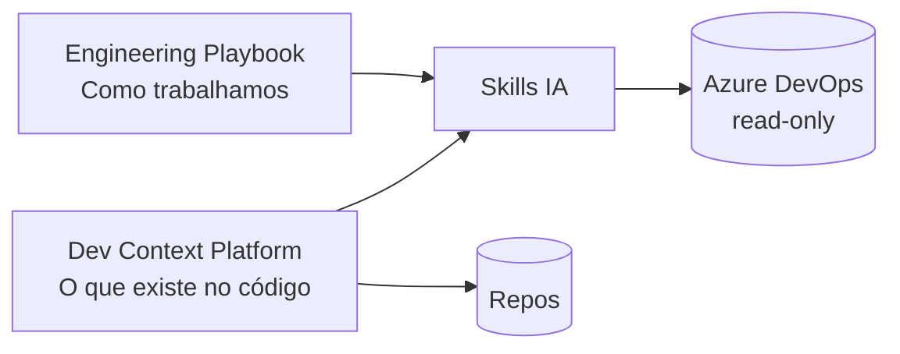

<!-- _class: lead -->
<!-- _paginate: false -->

# Ganhos Estratégicos

## Engineering Playbook + Dev Context Platform

**Público:** gestores, delivery, POs, tech leads  
**Status:** piloto AtivosCompraMobilizacao

---

<!-- _class: lead -->

# Resumo executivo

**Plataforma interna** que padroniza requisitos, valida prontidão, mapeia código e prepara desenvolvimento — com **IA assistida e guardrails**.

> *Institucionalizar conhecimento de engenharia e dar contexto confiável à IA — do refinamento ao primeiro commit.*

---

## Problema que resolve

| Dor atual | Consequência |
|-----------|--------------|
| Processo disperso | Retrabalho, inconsistência entre squads |
| Contexto técnico difícil de achar | Análise lenta, dependência de sênior |
| IA sem padrão | Alucinações, risco no Azure DevOps |
| Multi-repo sem mapa | US mal estimada, repos legados usados por engano |

---

## Dois pilares integrados



| Pilar | Papel |
|-------|-------|
| **Playbook** | Guidelines, playbooks, skills |
| **DCP** | project-map, KB, integration-graph |

---

## O problema estratégico (1/2)

### 1. Conhecimento frágil
Rotinas batch, views DW, repos legados — saem com as pessoas.

### 2. Custo oculto do refinamento
US entra na sprint incompleta → retrabalho, bugs, reuniões extras.

---

## O problema estratégico (2/2)

### 3. IA sem governança
Prompt livre, sem template, sem política ADO, sem contexto de código.

### 4. Complexidade multi-repo
**AtivosCompraMobilizacao:** 15+ repos. Sem mapa central, cada US vira caça ao tesouro.

---

## Engineering Playbook

| Tipo | Exemplo | Para quem |
|------|---------|-----------|
| Guideline | us-guidelines | Regra canônica |
| Template | us-template | Estrutura de documento |
| Playbook | sprint-planning | Cerimônias (pessoas) |
| Skill | sprint-readiness-reviewer | Agentes IA |

> **Processo versionado e auditável** — evolução via Pull Request.

---

## Pipeline ponta a ponta

```text
Descoberta → Refinamento → Feature → USs → Revisões → Sprint planning
                              ↓ NOVO ↓
                    Scan/KB → Plano implementação → Dev + QA
```

| Gate | Evita |
|------|-------|
| sprint-readiness | US incompleta na sprint |
| DCP verify | Plano com código desatualizado |
| us-implementation-planner | Dev começar do zero |

---

## Skills disponíveis hoje

| Domínio | Skills operacionais |
|---------|---------------------|
| **Product** | requirements-analyst, requirements-reviewer |
| **Delivery** | tech-lead-reviewer, sprint-readiness-reviewer, us-estimator |
| **Development** | project-scanner, dcp-bootstrap, us-implementation-planner |

**Portáveis:** Cursor, Claude Code, Antigravity — investimento não preso a uma IDE.

---

## Dev Context Platform — L0 → L5

| Camada | Artefato | Pergunta que responde |
|--------|----------|---------------------|
| L0 | project-map.yaml | Quais repos? Qual é legado? |
| L1 | repo-profile.yaml | Como é este repo? |
| L2–L3 | manifest + kb/nodes | Onde está a rotina/classe? |
| L5 | Código-fonte | Fallback quando KB stale |

`.engineering/` versionado **em cada repo de produto**.

---

## DCP na prática

| Comando | Função |
|---------|--------|
| `dcp init` | Primeiro scan + project-map |
| `dcp sync` | Scan incremental |
| `dcp verify` | Branch vs KB — **bloqueia plano stale** |

**Indexação determinística** (Roslyn + detectors) — **sem LLM** na documentação técnica.

---

## Ganhos — Gestão & Delivery

| Ganho | Como medir |
|-------|------------|
| Previsibilidade de sprint | % US "Pronta" no readiness |
| Menos carry-over | US devolvidas por lacuna |
| Visibilidade multi-repo | project-map active/legacy |
| Governança de IA | ADO read-only + skills versionadas |

---

## Ganhos — Analistas, Tech Leads, Devs

<div class="columns">

<div>

**Analistas / POs**
- Padrão único de US
- Onboarding 15–30 min
- Lacunas explícitas (sem inventar RN)

**Tech leads**
- Mapa de repos e legados
- Integration graph
- ADRs centralizados

</div>

<div>

**Desenvolvedores**
- Plano antes de codar
- RN → CA → tarefas → riscos
- Branch verify + KB searchable
- sync pós-PR mantém contexto

</div>

</div>

---

## Diferencial vs "só usar IA"

| Ad-hoc | Playbook + DCP |
|--------|----------------|
| Prompt livre | Skill + checklist |
| Contexto = memória | L0–L5 por keywords |
| Plano genérico | Plano cita commit/branch |
| IA escreve no ADO | **Somente leitura** |
| Doc "criativa" | Scan determinístico |

**Operacionalizamos IA** dentro do processo — não compramos ferramenta pontual.

---

## Governança e riscos

| Risco | Mitigação |
|-------|-----------|
| IA altera backlog | ADO MCP read-only |
| IA inventa RN | Skills proíbem; listam lacunas |
| Código desatualizado | verify bloqueia ref_stale / divergent |
| Repo legado por engano | project-map marca legacy |

> *O agente **assiste** — não substitui decisões humanas.*

---

## Piloto — AtivosCompraMobilizacao

**Caso real:** US-147722 — integração SAP / Atualização Diária SIMA

| Artefato | Prova |
|----------|-------|
| project-map.yaml | 15+ repos mapeados |
| integration-graph.md | Dependências detectadas |
| US-147722-01-plan.md | RN→CA→tarefas + riscos |
| Nota KB piloto | Contrato, fluxo, efeitos colaterais |

---

## Modelo de adoção

```text
Fase 1 (atual)     → Playbook + DCP + piloto
Fase 2             → project-map por produto + scan nos repos active
Fase 3             → QA skills + métricas + code-review assistido
```

| Item | Esforço |
|------|---------|
| Submodule / skills | Baixo · uma vez |
| project-map | Médio · por produto |
| scan sync | Baixo · contínuo |

---

## KPIs sugeridos (6 meses)

| KPI | Meta |
|-----|------|
| % US "Pronta" no readiness | > 80% |
| US devolvidas por lacuna | −50% |
| Tempo análise técnica pré-dev | −30% |
| Repos active indexados | 100% |
| Onboarding até 1ª PR | −25% |

*Medir baseline na sprint atual antes de comunicar metas.*

---

## Investimento vs retorno

**Custos:** manutenção playbook · scan inicial · treinamento (15–30 min)

**Retornos:** horas de análise · retrabalho evitado · turnover · IA com guardrails · replicabilidade

> *Playbook = ISO do processo. DCP = GIS do código.*

---

## FAQ

**Substitui dev/analista?** Não — prepara e revisa; humano decide.

**Só Cursor?** Não — Cursor, Claude Code, Antigravity; analista usa navegador.

**KB desatualizada?** verify detecta; sync incremental após merge.

**Infra nova?** Não — Python + git local; artefatos nos repos existentes.

---

<!-- _class: lead -->

# Call to action

1. **Patrocinar** playbook como repositório canônico
2. **Aprovar piloto DCP** como modelo para outros produtos
3. **Baseline de KPIs** na próxima sprint
4. **scan sync** no DoD de USs que alteram repos mapeados

### Próximos 30 dias
Semana 1: indexar repos · Semana 2: sprint-readiness · Semana 3: planos reais · Semana 4: retrospectiva KPIs

---

<!-- _class: lead -->
<!-- _paginate: false -->

# Obrigado

**docs/apresentacao-dcp-gestores.md** — material completo + speaker notes

engineering-playbook · project-context · skills
